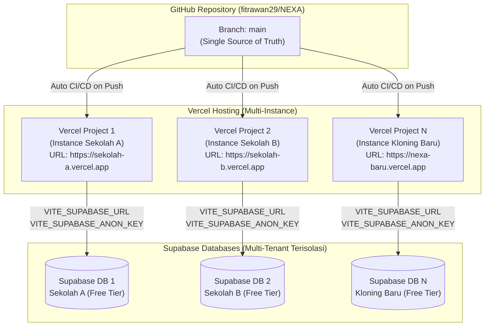

# Panduan Kloning Mandiri NEXA CBT (1 Repository Git, Supabase & Vercel Mandiri)

Panduan ini menjelaskan langkah demi langkah cara melakukan kloning dan penyebaran (*deployment*) instansi aplikasi **NEXA CBT** secara mandiri menggunakan:
- **1 Repositori GitHub Tunggal** (Branch `main`) sebagai sumber kode terpusat.
- **Database Supabase Terpisah** (Free Tier Rp 0) untuk memastikan seluruh data sekolah/siswa terisolasi penuh.
- **Hosting Vercel Terpisah** (Free Hobby Tier Rp 0) dengan domain instansi sendiri.

---

## 1. Arsitektur 1-Repository Multi-Deployment

Dalam arsitektur ini, seluruh instansi sekolah/klien menggunakan satu basis kode (*single codebase*) dari branch `main` GitHub. Pemisahan data dan konfigurasi dilakukan murni melalui **Environment Variables** pada level Vercel.



### Keuntungan Utama Pendekatan Ini:
1. **Pembaruan Satu Pintu (Zero Maintenance Overhead):** Ketika pengembang melakukan perbaikan bug atau rilis fitur ke branch `main`, seluruh instansi Vercel otomatis melakukan *build & redeploy* tanpa perlu merge branch berulang kali.
2. **Isolasi Data Mutlak:** Database tiap sekolah berdiri sendiri di Supabase terpisah. Data siswa, bank soal, dan hasil ujian tidak bercampur.
3. **Bebas Biaya (Rp 0):** Memaksimalkan fasilitas Free Tier Supabase (500 MB DB + 500 req/menit Kong Gateway) dan Vercel Hobby Tier per akun/proyek.

---

## 2. Tahap 1: Setup Database Supabase Baru

### Langkah 1.1: Buat Project Baru di Supabase
1. Buka browser dan login ke [Supabase Dashboard](https://supabase.com/dashboard).
2. Klik tombol **New project**.
3. Lengkapi form pembuatan proyek:
   - **Organization:** Pilih organisasi Anda.
   - **Name:** Beri nama proyek database (contoh: `nexa-db-sekolah-baru`).
   - **Database Password:** Buat password yang kuat dan catat dengan aman.
   - **Region:** Pilih **Singapore (`ap-southeast-1`)** untuk latensi tercepat dari Indonesia.
   - **Pricing Plan:** Pilih **Free Tier**.
4. Klik **Create new project** dan tunggu proses provisi database selesai (sekitar 1-2 menit).

---

### Langkah 1.2: Eksekusi Skema Database Master
NEXA CBT telah menyediakan skrip DDL master terpadu yang membuat 21 tabel, indeks performa, stored procedure submit atomik, serta inisialisasi akun awal.

1. Pada dashboard project Supabase yang baru dibuat, buka menu **SQL Editor** pada sidebar kiri.
2. Klik tombol **New query**.
3. Buka file **`database_backups/schema_master_init.sql`** yang ada di repositori ini, salin seluruh kodenya, lalu tempelkan (*paste*) ke SQL Editor.
4. Klik tombol **Run** (atau tekan `Ctrl + Enter`).
5. Pastikan muncul notifikasi **Success. No rows returned**.
6. Buka menu **Table Editor** untuk memverifikasi bahwa ke-21 tabel berikut telah terbuat:
   - `sekolah`, `super_admin`, `admin`, `guru`, `mata_pelajaran`, `kelas`, `siswa`, `guru_mapel`, `jadwal`, `ruang_ujian`, `soal_ujian`, `log_ujian`, `jawaban_siswa`, `pengawas_ruang`, `absensi_ujian`, `berita_acara_ujian`, `audit_log`, `audit_log_archive`, `pengumuman`, `pengumuman_global`, `log_aktivitas_global`.

---

### Langkah 1.3: Ambil Kredensial API Supabase
1. Masuk ke menu **Project Settings** (ikon gerigi di kiri bawah) > **API**.
2. Salin 2 nilai kredensial berikut dan simpan sementara di catatan:
   - **Project URL:** Contoh: `https://abcdefghijklmn.supabase.co`
   - **Project API Keys** bagian **`anon` / `public`:** Token JWT panjang berawalan `eyJhbGciOi...`

> [!CAUTION]
> **JANGAN PERNAH** menggunakan `service_role` key pada environment variable front-end Vercel karena key tersebut memiliki akses *bypass RLS root* yang berbahaya jika terekspos ke klien.

---

### Langkah 1.4: (Opsional / Direkomendasikan) Setup Google Drive Webhook Media Soal
Untuk menjaga ukuran database Supabase Free Tier tetap di bawah batas 500 MB, media gambar dan audio soal ujian dapat diarahkan langsung ke Google Drive sekolah:

1. Buka [Google Apps Script](https://script.google.com).
2. Klik **New project**, beri nama `NEXA Drive Webhook`.
3. Hapus kode default, lalu salin isi file **`scripts/google_apps_script_drive_uploader.js`** ke editor.
4. Klik tombol **Deploy** > **New deployment**.
5. Klik ikon gerigi (Select type) > pilih **Web app**.
6. Konfigurasi:
   - **Description:** `NEXA Soal Uploader`
   - **Execute as:** `Me` (email Anda)
   - **Who has access:** `Anyone` *(Wajib pilih 'Anyone' agar webhook dapat diakses)*.
7. Klik **Deploy**, beri izin hak akses (*Authorize access*), lalu salin **Web app URL** (berakhiran `/exec`).
8. URL ini nantinya dapat dimasukkan melalui panel Admin: **Pengaturan Sekolah > URL Webhook Google Drive**.

---

## 3. Tahap 2: Setup Hosting Vercel Menggunakan 1 Repositori Git

### Langkah 2.1: Impor Repositori ke Vercel
1. Buka dan login ke dashboard [Vercel](https://vercel.com).
2. Klik tombol **Add New...** di kanan atas > pilih **Project**.
3. Pada daftar repositori GitHub, cari repositori NEXA Anda (contoh: `fitrawan29/NEXA`) lalu klik **Import**.

---

### Langkah 2.2: Konfigurasi Project Settings
Pada halaman **Configure Project**:

1. **Project Name:** Beri nama unik untuk instansi ini (contoh: `nexa-sekolah-baru`). Nama ini akan menjadi subdomain bawaan: `https://nexa-sekolah-baru.vercel.app`.
2. **Framework Preset:** Pastikan terpilih **`Vite`** (terdeteksi otomatis).
3. **Root Directory:** Biarkan default `./` (karena file `package.json` berada di root repositori).
4. **Build and Output Settings:** Biarkan sesuai default atau `vercel.json` bawaan:
   - Build Command: `npm run build`
   - Output Directory: `dist`

---

### Langkah 2.3: Masukkan Environment Variables
Buka bagian **Environment Variables** sebelum menekan deploy. Tambahkan 2 variabel berikut:

| Key | Value | Target Environment |
|---|---|---|
| `VITE_SUPABASE_URL` | Masukkan **Project URL** dari Langkah 1.3 | Production, Preview, Development |
| `VITE_SUPABASE_ANON_KEY` | Masukkan **anon public key** dari Langkah 1.3 | Production, Preview, Development |

> [!IMPORTANT]
> Pastikan centang ketiga opsi target: **Production**, **Preview**, dan **Development**. Variabel ini akan diinjeksi saat Vite melakukan proses kompilasi kode (`npm run build`).

---

### Langkah 2.4: Deploy Proyek
1. Klik tombol **Deploy**.
2. Vercel akan mengkloning kode dari branch `main`, menginstal dependencies, dan menjalankan build Vite.
3. Tunggu hingga proses selesai (biasanya ~1-2 menit) hingga muncul tampilan kembang api dan tombol **Go to Dashboard** / **Visit**.
4. Buka URL domain yang dihasilkan (misal `https://nexa-sekolah-baru.vercel.app`).

---

## 4. Tahap 3: Uji Coba & Konfigurasi Awal Aplikasi

Setelah deployment aktif, lakukan inisialisasi awal pada website baru Anda:

### 1. Login Pertama Kali sebagai Administrator
- Buka URL Vercel aplikasi Anda di browser.
- Gunakan kredensial awal bawaan dari `schema_master_init.sql`:
  - **Username:** `admin`
  - **Password:** `admin123`
- Setelah berhasil masuk, Anda akan diarahkan ke halaman **Admin Dashboard**.

### 2. Kustomisasi Profil Sekolah
1. Masuk ke tab **Profil / Pengaturan Sekolah**.
2. Ubah data sekolah default (`SMA NEGERI CONTOH` / NPSN `10000001`):
   - **NPSN:** Sesuaikan dengan NPSN sekolah asli.
   - **Nama Sekolah:** Masukkan nama sekolah resmi.
   - **Alamat & Kop Surat:** Unggah logo sekolah dan atur kop surat untuk kartu ujian dan berita acara.
   - **Google Drive Webhook:** Tempelkan Web app URL dari Langkah 1.4 jika menggunakan Google Drive.
3. Simpan perubahan.

### 3. Amankan Akun Admin
1. Masuk ke pengaturan akun/pengguna di panel admin.
2. Segera ganti password akun `admin` default dengan password baru yang kuat.

### 4. Input Data Operasional
1. Daftarkan **Tahun Ajaran**, **Mata Pelajaran**, dan **Kelas**.
2. Daftarkan akun **Guru** dan alokasi mapelnya.
3. Daftarkan data **Siswa** (dapat menggunakan fitur impor Excel/CSV yang tersedia).
4. Buat satu jadwal ujian simulasi untuk menguji ruang ujian siswa (*ExamRoom*).

---

## 5. Tahap 4: Alur Kerja Pemeliharaan (CI/CD Otomatis)

Karena seluruh deployment terhubung ke branch tunggal `main`, pemeliharaan aplikasi sangat mudah:

### Pembaruan Fitur & Perbaikan Bug Front-End:
1. Pengembang melakukan perubahan kode lokal pada repositori NEXA.
2. Lakukan commit dan push ke branch `main`:
   ```bash
   git add .
   git commit -m "fix(exam): tingkatkan performa sinkronisasi jawaban"
   git push origin main
   ```
3. **Vercel CI/CD Otomatis:** Vercel pada seluruh project (baik instance pusat maupun seluruh instance kloning) akan secara otomatis mendeteksi commit baru, memicu build ulang, dan memperbarui aplikasi ke versi terbaru tanpa *downtime*.
4. **Data Database Aman:** Pembaruan kode di Vercel tidak menyentuh atau menghapus data apa pun di database Supabase masing-masing instansi.

### Pembaruan Skema Database (Jika Ada Migrasi di Masa Depan):
Jika di kemudian hari ada fitur baru yang membutuhkan kolom atau tabel baru:
1. Pengembang akan menyertakan file skrip SQL di folder `database_backups/` (contoh: `migration_xxx.sql`).
2. Admin/operator masing-masing instansi cukup membuka **SQL Editor** pada project Supabase mereka dan menjalankan skrip migrasi tersebut satu kali.

---

## 6. Troubleshooting & Solusi Masalah Umum

### 1. Halaman Tampil Putih / Error "Supabase connection failed"
- **Penyebab:** Environment variable salah ketik atau belum terpasang.
- **Solusi:** Buka Vercel Dashboard > Project Anda > **Settings** > **Environment Variables**. Pastikan nama key persis:
  - `VITE_SUPABASE_URL`
  - `VITE_SUPABASE_ANON_KEY`
  Setelah mengubah variable, klik tab **Deployments** > klik titik tiga di deployment terakhir > pilih **Redeploy**.

### 2. Gagal Submit Ujian / Error `function submit_ujian_atomic does not exist`
- **Penyebab:** Stored procedure belum terbuat atau hak akses eksekusi belum diberikan ke role `anon`.
- **Solusi:** Buka SQL Editor di Supabase, jalankan skrip berikut:
  ```sql
  GRANT EXECUTE ON FUNCTION public.submit_ujian_atomic(VARCHAR, JSONB, VARCHAR, NUMERIC) TO anon, authenticated, service_role;
  ```

### 3. Siswa Terlempar Keluar Saat Menekan F5
- **Penyebab:** NEXA CBT telah mengamankan sesi siswa melalui `sessionStorage` (`nexa_user_session`). Jika terjadi masalah, pastikan browser siswa tidak dalam mode *Incognito/Private Browsing* yang memblokir penyimpanan sesi lokal.

### 4. Batas Kuota Gratis Supabase Free Tier
- **Tips:** Supabase memberikan kuota gratis database 500 MB per project. Untuk mencegah kepenuhan:
  - Gunakan webhook Google Drive untuk file gambar/audio soal.
  - Lakukan pembersihan log ujian berkala via panel Admin setelah periode semester/ujian selesai.
